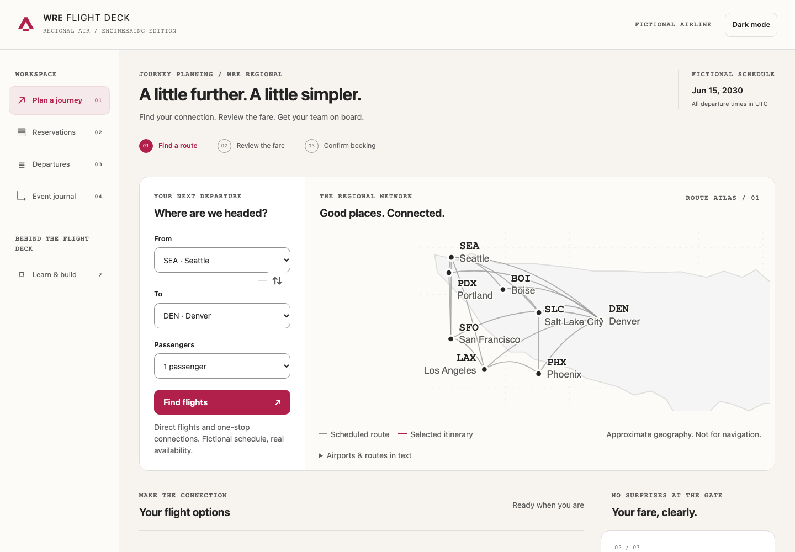

# WRE Flight Deck

**One airline. Twelve independent engineering sessions. Real working code.**

Flight Deck is a local regional-airline operations desk. Find a direct or
connecting flight, price an itinerary, reserve seats, manage departures, and
trace the resulting events. Each part uses the same inventory and business
rules. Nothing depends on finishing an earlier week's exercise.

All flights, fares, aircraft and team callsigns are fictional. This application
does not contact an airline, move money, store passenger identities or operate
aircraft. The engineering behavior is real; the airline is illustrative.



Actual local application, fictional schedule. Captured November 13, 2026.

## Get airborne

Install **Node.js 24 or newer**, then:

```sh
git clone https://github.com/msfttoler/wre-flight-deck.git
cd wre-flight-deck
npm start
```

Open **http://127.0.0.1:3000**. No `npm install`, API keys, containers or cloud
subscription are needed to run the application.

1. In **From**, select **SEA · Seattle**. In **To**, select **DEN · Denver**.
   Set **Passengers** to **1 passenger**, then click **Find flights**.
2. Compare the options by stops, UTC times, available seats and base fare.
   Click **Review fare** on the itinerary you want.
3. Under **Checked bags**, choose **1 bag / passenger**. Enter `FIRSTFLIGHT`
   in **Coupon (optional)**, click **Calculate fare**, and read every price
   line and **Total · USD**. The coupon discounts base fare, not bag fees. A
   quote expires after 15 minutes and does not reserve a seat.
4. Enter a unique synthetic label, such as `TEAM-ORBIT-A1`, in **Fictional
   team callsign**. Click **Confirm fictional booking** once. Wait for
   **BOOKING CONFIRMED** and note the reference. Do not enter a person's name
   or payment details.
5. Click **View reservations** or open **Reservations** from the workspace
   menu. Find your callsign and verify its reference, route, total and
   **confirmed** status.

The Plan a journey screen also has optional, exact steps for updating a
fictional departure, checking its local event, and cancelling only the booking
you just made. Departure updates persist in `.data/`; do not delete that
directory to reset a lesson. A local event is not a GitHub webhook or CI run.

Dates describe the labeled fictional schedule, not today's flights. Quoted
prices expire after 15 real minutes. A quote does not hold a seat.

## Pick a week, not a prerequisite chain

**[Start here: all 12 sessions](docs/sessions.md)** ·
[Contributing and native tests](CONTRIBUTING.md) ·
[Architecture](docs/architecture.md) · [API](docs/api-contract.md) ·
[Copilot delivery loop](docs/agentic-sdlc.md)

Every week starts from the same **`wre-v1` source baseline** with a clean clone
and its own branch when editing is needed. No week imports another learner's
work. Local application state is separate from Git history.

The on-screen quick-start guide is on `main`. The approved `wre-v1` tag is an
earlier baseline and does not include that guide; use the numbered steps above
when running the app from `wre-v1`.

| Week | Your engineering task |
| --- | --- |
| [01](docs/week-01.md) | Recover a useful change without rewriting shared history |
| [02](docs/week-02.md) | Explain the difference between a test result and a merge gate |
| [03](docs/week-03.md) | Identify the account, credential and effective repository access |
| [04](docs/week-04.md) | Trace a real workflow run and its actual checkout |
| [05](docs/week-05.md) | Verify a release asset and its producer |
| [06](docs/week-06.md) | Investigate an accessible CodeQL finding, if one exists |
| [07](docs/week-07.md) | Take a real change request through an Agentic SDLC |
| [08](docs/week-08.md) | Use Copilot and MCP with source-grounded context and explicit authority |
| [09](docs/week-09.md) | Investigate real GitHub App activity and evidence limits |
| [10](docs/week-10.md) | Compare workflow configuration with an accepted baseline |
| [11](docs/week-11.md) | Inventory migration readiness and preservation requirements |
| [12](docs/week-12.md) | Decide whether the release evidence supports a candidate |

Hosted exercises use actual accessible objects. No alert, denied permission,
failed check, webhook delivery or review is fabricated to make a lesson work.
Missing objects or access remain **blocked**. See [delivery status](docs/status.md).

## Interoperable, not entangled

```text
Airport network -> itinerary planner -> fare quote -> reservation
                         |                  |             |
                  inventory checks    integer money   seat allocation
                         |                                |
                         +--------- departure board ------+
                                           |
                              correlated event journal
```

The planner, fare rules and reservation rules are ordinary modules with native
tests. The browser calls the same HTTP API you can inspect with `curl`. There
are no lesson runners, hidden graders or solution scripts.

## Work on the code

```sh
npm test
```

Browser tests are optional developer tooling, not runtime requirements:

```sh
npm ci
npx playwright install chromium
npm run test:e2e
```

`PORT=3001 npm start` changes the local port. `DATA_DIR=/absolute/new/directory
npm start` starts an independent state store. Stop the old process first or use
a different port. Never point two server processes at the same state directory.
Keep an old directory to preserve work rather than deleting it to start a class.

## Scope

This is a local, single-process teaching application, **not an internet-facing
booking service**. It has no user authentication, payment processing, aviation
data feed or multi-instance database. Do not bind it publicly or enter real
passenger data. GitHub/Copilot access, entitlements and organization policies
are separate from running the application.

Original project code is provided under the [MIT license](LICENSE).
